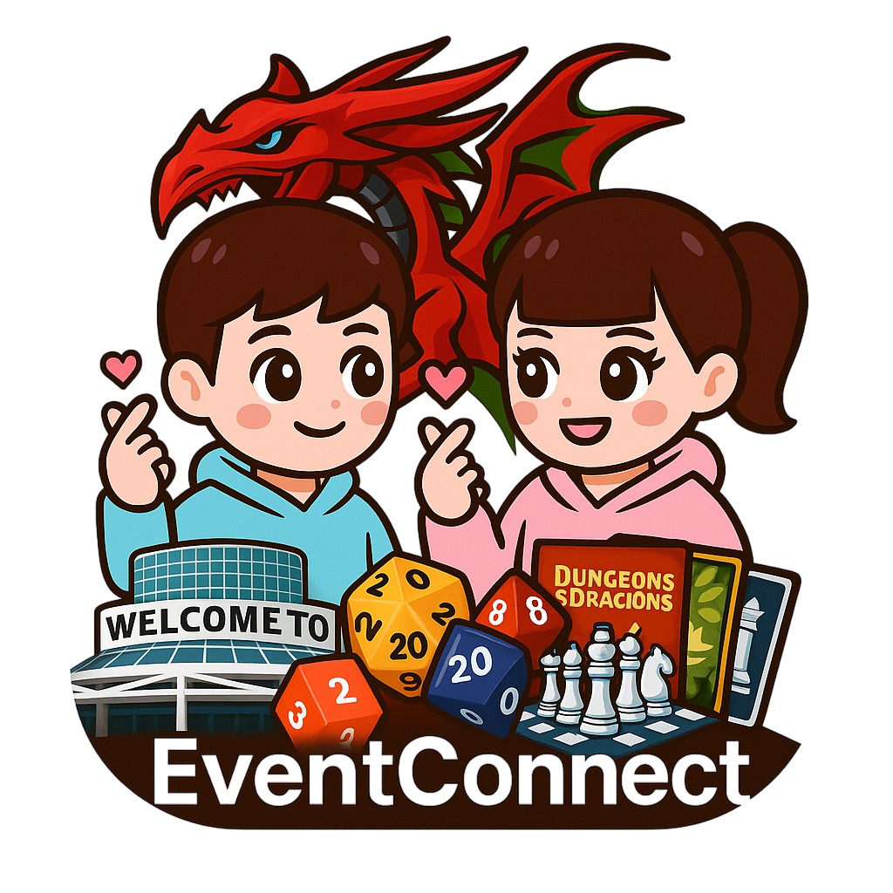

# 🎟️ EventConnect

  

  

Conecta tiendas/productoras con su comunidad: descubre, crea y gestiona eventos desde una app nativa Android hecha con Kotlin + Jetpack Compose.

  
  
  
  

---

## ✨ ¿Qué es EventConnect?
EventConnect es una app móvil que centraliza eventos de hobby/entretenimiento (TCG, juegos de mesa, ferias, etc.). Permite que tiendas/productoras creen y gestionen eventos, mientras que usuarios comunes exploran, guardan recordatorios y solicitan cupos.

---

## 🌟 Highlights de esta versión
- UI moderna con Jetpack Compose (Material 3) + carrusel de imágenes en detalle del evento.
- Pantalla de Splash con barra de progreso y porcentaje; animación sincronizada con GIF (Pikachu) y logo de la app.
- Home diferenciada por tipo de usuario:
  - Tienda/Productor: ver y administrar eventos propios (FAB para crear, menú con acciones).
  - Usuario común: filtros por Región/Comuna/Categoría y sugerencia por ubicación.
- Reservas mejoradas:
  - Usuario común: “Mis reservas” con UI más clara, estados y filtros.
  - Tienda/Productor: “Solicitudes” con acciones rápidas.
  - Pull-to-refresh en ambas vistas.
- Recordatorios para eventos SIN cupo:
  - Opción “Calendario” para crear cita en el calendario del teléfono.
  - Opción “Recordatorio 8:00” (WorkManager) que programa una notificación local a las 8:00 AM el día del evento.
- Edición de imágenes:
  - Soporte de múltiples fotos por evento (galería y cámara).
  - En perfiles: seleccionar desde galería o cámara y editar (recortar, girar, espejo).
- Notificaciones locales de cambios en eventos: si diste “like” o tienes cupo aprobado, recibes avisos cuando el organizador modifica datos clave (fecha, dirección, comuna/ región, etc.).
- Flujo de eliminar cuenta con confirmación (contraseña + escribir “eliminar”) y cierre de sesión automático.

> Nota: la verificación de conectividad dinámica en el arranque está planificada para la próxima versión (ver Roadmap). La app hoy prioriza la experiencia local y prepara el terreno para sincronización con backend.

---

## 🧭 Navegación principal
- Splash → Login/Registro → Home → Detalle de evento
- Vistas adicionales: Crear/Editar evento, Mis reservas (usuario común), Solicitudes (tienda/productor), Perfil

---

## 🧩 Arquitectura
- Patrón: MVVM (Model–View–ViewModel)
- Capa de datos: Room (DAOs + Entities) y Repositorios
- Capa de dominio: lógica de negocio simple dentro de repositorios y/o ViewModels
- Capa de presentación: Jetpack Compose (Material 3), StateFlow/collectAsState

Estructura simplificada:
- data/ → entidades Room (User, Event, Reservation, PendingOperation, EventUpdateNotice, etc.)
- repository/ → acceso a Room y coordinación de operaciones
- ui/ → pantallas Compose (Home, EventDetail, Login, Profile, etc.)
- ui/vm/ → ViewModels (HomeViewModel, EventDetailViewModel, etc.)

---

## 🛠️ Tecnologías
- Kotlin, Coroutines y Flow
- Jetpack Compose (Material 3, Scaffold, TopAppBar, etc.)
- Room Database (persistencia local)
- WorkManager (notificación/recordatorio a las 8:00 AM)
- Coil (carga de imágenes)

---

## 🔐 Permisos utilizados
- Cámara
- Almacenamiento/Imágenes (lectura de galería)
- Ubicación aproximada/precisa (sugerencia de Región/Comuna en Home del usuario común)
- Calendario (insertar evento/cita) – cuando el usuario lo solicita

> Todos los permisos se solicitan en contexto y sólo cuando se requieren.

---

## 📸 Capturas y gifs
> Reemplaza estos placeholders con capturas reales de tu emulador/dispositivo.

| Splash | Home (usuario común) | Detalle evento | Crear/Editar evento |
|---|---|---|---|
|  |  |  |  |

GIF sugeridos:
- Barra de carga + Pikachu animado en Splash
- Carrusel en detalle del evento (deslizar entre fotos)
- Acciones de “Calendario” y “Recordatorio 8:00”

---

## ▶️ Cómo ejecutar el proyecto
1) Requisitos
- Android Studio (Giraffe/Koala o superior)
- Gradle Wrapper incluido en el repo
- JDK 17 (recomendado)

2) Pasos
- Clona el repositorio
- Abre el proyecto en Android Studio
- Sincroniza Gradle
- Ejecuta en emulador o dispositivo físico

> Si ves errores relacionados con el JDK (por ejemplo “25.0.1”), en Android Studio ve a: Settings → Build, Execution, Deployment → Gradle → Gradle JDK = JDK 17 (o el Embedded JDK que sea 17).

---

## 🧪 Funcionalidades clave (detalle)
- Splash personalizado: barra con % y GIF sincronizado. Logo centrado.
- Home adaptativa por tipo de usuario; chips para filtrar región, comuna y categoría; sugerencia por geolocalización (opcional).
- Detalle de evento: carrusel “snap” con efecto escala/opacidad; pinch & pan en zoom modal.
- Reservas/solicitudes: UI pulida + pull-to-refresh; mensajes claros de estado.
- Recordatorios: inserción en Calendario del teléfono y/o notificación local a las 8:00 AM (WorkManager).
- Perfiles: edición con cámara/galería y herramientas básicas (recortar, girar, espejo).
- Eliminación de cuenta con doble confirmación y cierre de sesión automático.

---

## 🗺️ Roadmap (próxima versión)
- Backend y sincronización offline-first:
  - API REST (por definir) + Retrofit.
  - Encolar operaciones locales (Room) y sincronizar cuando haya conectividad.
  - Detección de conectividad en Splash y estrategia transparente para el usuario.
- Validación de direcciones: integración con Google Maps/Geocoding para verificar calle + numeración.
- Push Notifications (FCM) para avisos de cambios y eventos destacados.
- Carrusel con Compose Pager (o migración a la versión estable si aplica) con paginado “snap” más fluido y gestos mejorados.

---

## 🤝 Contribuciones
¡Bienvenidas! Abre un issue para sugerencias/bugs o envía un PR con mejoras.

---

## 👥 Autores
- **Eduardo Lizama** — [@Paladynamo](https://github.com/Paladynamo)
- **Germán Ormeño** — [@GersebO](https://github.com/GersebO)

---

## 📄 Licencia
Este proyecto está bajo la licencia MIT. Consulta el archivo `LICENSE` para más detalles.

---

> ✨ EventConnect — Conecta, crea y vive experiencias únicas.
