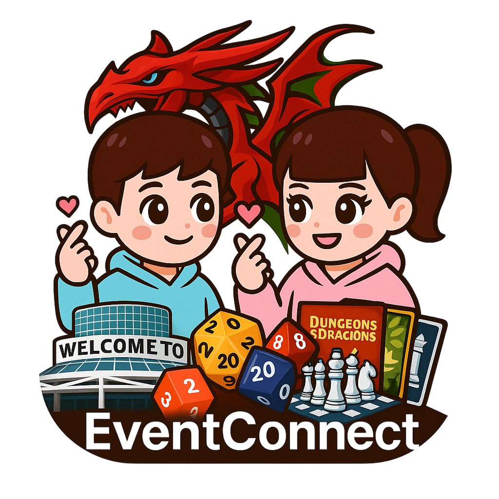

<div align="center">

# 🎟️ EventConnect

<p align="center">
  
</p>

<div style="display:inline-block;height:10px;width:88%;min-width:320px;background:linear-gradient(90deg,#6D4C41 0%,#FFB74D 50%,#F57C00 100%);border-radius:8px;"></div>

### Conecta tiendas/productoras con su comunidad: descubre, crea y gestiona eventos desde una app nativa Android

[](https://www.android.com/)
[](https://kotlinlang.org/)
[](https://developer.android.com/jetpack/compose)
[](https://spring.io/projects/spring-boot)
[](https://developer.android.com/topic/architecture)
[](LICENSE)

</div>

---

## 📑 Tabla de Contenidos

- [✨ ¿Qué es EventConnect?](#-qué-es-eventconnect)
- [🌟 Características Principales](#-características-principales)
- [🏗️ Arquitectura](#️-arquitectura)
- [📦 Instalación](#-instalación)
  - [📱 Aplicación Android](#-aplicación-android)
  - [🔌 API Backend](#-api-backend)
- [⚙️ Configuración](#️-configuración)
- [📖 Guía de Uso](#-guía-de-uso)
  - [👤 Para Usuarios](#-para-usuarios)
  - [🏪 Para Tiendas/Productoras](#-para-tiendasproductoras)
- [🔌 Documentación de API](#-documentación-de-api)
- [📁 Estructura del Proyecto](#-estructura-del-proyecto)
- [🛠️ Tecnologías Utilizadas](#️-tecnologías-utilizadas)
- [🔐 Permisos](#-permisos)
- [🧪 Testing](#-testing)
- [🗺️ Roadmap](#️-roadmap)
- [🤝 Contribución](#-contribución)
- [👥 Autores](#-autores)
- [📄 Licencia](#-licencia)

---

## ✨ ¿Qué es EventConnect?

**EventConnect** es una plataforma completa que conecta tiendas y productoras con su comunidad de aficionados. La aplicación permite descubrir, crear y gestionar eventos de hobby y entretenimiento como:

- 🎴 **TCG** (Trading Card Games): Magic: The Gathering, Yu-Gi-Oh!, Pokémon, etc.
- 🎲 **Juegos de Mesa**: Torneos, noches de juegos, eventos temáticos
- 🎪 **Eventos Especiales**: Ferias, convenciones, meetups

### Componentes del Proyecto

1. **📱 Aplicación Android** (`EventConnect/app/`): App nativa desarrollada con Kotlin y Jetpack Compose
2. **🔌 API Backend** (`Api/`): Servidor REST desarrollado con Spring Boot y Kotlin
3. **⚡ Servidor Ktor** (`EventConnect/server/`): Servidor alternativo simple para desarrollo/MVP

---

## 🌟 Características Principales

### 🎨 Interfaz de Usuario Moderna

- ✨ **UI con Jetpack Compose** y Material Design 3
- 🎬 **Pantalla Splash** animada con barra de progreso y GIF sincronizado
- 🖼️ **Carrusel de imágenes** en detalle de eventos con efectos de escala y opacidad
- 📸 **Zoom modal** con gestos pinch & pan para imágenes
- 🎯 **Navegación fluida** con Navigation Compose

### 👥 Funcionalidades para Usuarios

- 🔍 **Exploración de eventos** con filtros avanzados (Región, Comuna, Categoría)
- 📍 **Sugerencia por ubicación** usando GPS del dispositivo
- 💾 **Sistema de intereses** (likes) para guardar eventos favoritos
- 🎫 **Reservas de cupos** con estados claros (Pendiente, Aprobada, Rechazada)
- 📅 **Recordatorios inteligentes**:
  - Inserción en calendario del teléfono
  - Notificación local a las 8:00 AM el día del evento (WorkManager)
- 🔔 **Notificaciones** de cambios en eventos de interés
- 👤 **Perfil personalizable** con edición de imágenes (recortar, girar, espejo)

### 🏪 Funcionalidades para Tiendas/Productoras

- ➕ **Creación de eventos** con múltiples imágenes
- ✏️ **Edición completa** de eventos propios
- 🎯 **Control de capacidad** (con/sin cupos limitados)
- 📋 **Gestión de solicitudes** de reserva (aprobar/rechazar con motivo)
- 📊 **Vista de eventos propios** con acciones rápidas
- 🏷️ **Perfil de tienda** personalizable

### 🔄 Sincronización Offline-First

- 💾 **Persistencia local** con Room Database
- 📤 **Encolado de operaciones** cuando no hay conectividad
- 🔄 **Sincronización automática** cuando se restaura la conexión
- ✅ **Sistema de operaciones pendientes** (`PendingOperation`)

### 🔔 Sistema de Notificaciones

- 📱 **Notificaciones locales** para cambios en eventos
- ⏰ **Recordatorios programados** con WorkManager
- 🔔 **Avisos de actualizaciones** en eventos con cupo aprobado o interés

---

## 🏗️ Arquitectura

### 📱 Aplicación Android

El proyecto sigue el patrón **MVVM (Model-View-ViewModel)** con las siguientes capas:

```
┌─────────────────────────────────────────┐
│         Capa de Presentación            │
│  (Jetpack Compose + ViewModels)         │
├─────────────────────────────────────────┤
│         Capa de Dominio                 │
│  (Repositorios + Lógica de Negocio)     │
├─────────────────────────────────────────┤
│         Capa de Datos                   │
│  (Room Database + Remote API)           │
└─────────────────────────────────────────┘
```

#### Estructura de Carpetas

```
app/src/main/java/com/example/eventconnect/
├── data/                    # Entidades Room y DAOs
│   ├── User.kt
│   ├── Event.kt
│   ├── Reservation.kt
│   ├── PendingOperation.kt
│   ├── EventUpdateNotice.kt
│   └── AppDatabase.kt
├── repository/              # Repositorios para acceso a datos
│   ├── EventRepository.kt
│   ├── ReservationRepository.kt
│   └── ...
├── ui/                      # Pantallas Compose
│   ├── HomeScreen.kt
│   ├── LoginScreen.kt
│   ├── EventDetailScreen.kt
│   ├── ProfileScreen.kt
│   └── vm/                  # ViewModels
│       ├── HomeViewModel.kt
│       └── ...
├── remote/                  # Servicios Retrofit
│   ├── service/
│   │   ├── AuthService.kt
│   │   ├── EventService.kt
│   │   └── ...
│   └── RetrofitProvider.kt
├── sync/                    # Sincronización offline
├── notification/            # Notificaciones locales
└── reminder/                # Recordatorios con WorkManager
```

### 🔌 API Backend

El backend está desarrollado con **Spring Boot** y sigue una arquitectura en capas:

```
┌─────────────────────────────────────────┐
│         Controller Layer                │
│  (REST Endpoints)                       │
├─────────────────────────────────────────┤
│         Service Layer                   │
│  (Lógica de Negocio)                    │
├─────────────────────────────────────────┤
│         Repository Layer                │
│  (Acceso a Datos - JPA)                 │
├─────────────────────────────────────────┤
│         Database                        │
│  (PostgreSQL)                           │
└─────────────────────────────────────────┘
```

#### Estructura de Carpetas

```
Api/src/main/kotlin/com/eventconnect/eventconnect/
├── controller/              # Controladores REST
│   ├── AuthController.kt
│   ├── EventController.kt
│   └── ...
├── service/                 # Servicios de negocio
│   ├── AuthService.kt
│   ├── EventService.kt
│   └── ...
├── repository/              # Repositorios JPA
├── domain/                 # Entidades de dominio
├── dto/                    # Data Transfer Objects
└── config/                 # Configuraciones
```

---

## 📦 Instalación

### 📱 Aplicación Android

#### Requisitos Previos

- **Android Studio** (Giraffe/Koala o superior)
- **JDK 17** (recomendado)
- **Android SDK** (API 24 mínimo, API 34 target)
- **Gradle** (incluido en el proyecto)

#### Pasos de Instalación

1. **Clonar el repositorio**
   ```bash
   git clone <repository-url>
   cd EventConnect/EventConnect
   ```

2. **Abrir en Android Studio**
   - Abre Android Studio
   - Selecciona `File → Open` y navega a la carpeta `EventConnect/EventConnect`
   - Espera a que Gradle sincronice el proyecto

3. **Configurar JDK**
   - Ve a `File → Settings → Build, Execution, Deployment → Build Tools → Gradle`
   - En `Gradle JDK`, selecciona **JDK 17** (o el Embedded JDK 17)

4. **Configurar API Key (Opcional)**
   - Si deseas usar Google Maps, crea un archivo `local.properties` en la raíz del proyecto:
   ```properties
   MAPS_API_KEY=tu_api_key_aqui
   ```

5. **Ejecutar la aplicación**
   - Conecta un dispositivo físico o inicia un emulador
   - Haz clic en `Run` (▶️) o presiona `Shift + F10`

#### Configuración de Red

Para que la app se conecte al backend local:

- **Emulador Android**: Usa `http://10.0.2.2:8080` (ya configurado)
- **Dispositivo físico**: 
  1. Asegúrate de que el dispositivo y la PC estén en la misma red WiFi
  2. Reemplaza `10.0.2.2` con la IP local de tu PC en `RetrofitProvider.kt`

### 🔌 API Backend

#### Requisitos Previos

- **Java 21** o superior
- **Maven 3.6+** o superior
- **PostgreSQL** (base de datos)
- **IDE** (IntelliJ IDEA recomendado)

#### Pasos de Instalación

1. **Configurar Base de Datos PostgreSQL**

   Crea una base de datos PostgreSQL:
   ```sql
   CREATE DATABASE eventconnect_db;
   ```

2. **Configurar Credenciales**

   Edita `Api/src/main/resources/application.properties`:
   ```properties
   spring.datasource.url=jdbc:postgresql://localhost:5432/eventconnect_db
   spring.datasource.username=tu_usuario
   spring.datasource.password=tu_contraseña
   ```

3. **Compilar y Ejecutar**

   **Opción A: Con Maven**
   ```bash
   cd Api
   ./mvnw clean install
   ./mvnw spring-boot:run
   ```

   **Opción B: Con IDE**
   - Abre el proyecto en IntelliJ IDEA
   - Localiza `EventconnectApplication.kt`
   - Ejecuta la clase principal

4. **Verificar que funciona**

   Abre tu navegador y visita:
   ```
   http://localhost:8080/api/health
   ```

   Deberías ver:
   ```json
   {"status": "ok"}
   ```

#### Configuración de CORS

El backend está configurado para aceptar peticiones desde la app Android. Si necesitas configurar CORS para otros orígenes, edita la configuración en `Api/src/main/kotlin/com/eventconnect/eventconnect/config/`.

---

## ⚙️ Configuración

### Variables de Entorno (Backend)

Crea un archivo `.env` o configura las siguientes variables en `application.properties`:

```properties
# Base de Datos
spring.datasource.url=jdbc:postgresql://localhost:5432/eventconnect_db
spring.datasource.username=usuario
spring.datasource.password=contraseña

# Puerto del servidor
server.port=8080

# JPA/Hibernate
spring.jpa.hibernate.ddl-auto=update
spring.jpa.show-sql=true
```

### Configuración de la App Android

#### URL del Backend

Edita `EventConnect/app/src/main/java/com/example/eventconnect/remote/RetrofitProvider.kt`:

```kotlin
private const val BASE_URL = "http://10.0.2.2:8080/api/"  // Emulador
// O para dispositivo físico:
// private const val BASE_URL = "http://192.168.1.X:8080/api/"
```

#### Permisos

Los permisos se solicitan automáticamente en tiempo de ejecución. Asegúrate de que estén declarados en `AndroidManifest.xml` (ya incluidos):

- `INTERNET`
- `CAMERA`
- `ACCESS_FINE_LOCATION`
- `ACCESS_COARSE_LOCATION`
- `POST_NOTIFICATIONS` (Android 13+)

---

## 📖 Guía de Uso

### 👤 Para Usuarios

#### 1. Registro e Inicio de Sesión

1. **Registro**
   - Abre la app (se mostrará la pantalla de Splash)
   - Selecciona "Registrarse"
   - Elige el tipo de cuenta: **Usuario** o **Tienda/Productora**
   - Completa el formulario con:
     - Nombre
     - Email
     - Contraseña (mínimo 6 caracteres)
     - Si eres tienda: nombre de la tienda

2. **Inicio de Sesión**
   - Ingresa tu email y contraseña
   - La app guardará tu sesión automáticamente

#### 2. Explorar Eventos

1. **Filtros Disponibles**
   - **Región**: Filtra por región de Chile
   - **Comuna**: Filtra por comuna específica
   - **Categoría**: TCG, Juegos de Mesa, Eventos
   - **Sugerencia por ubicación**: Activa GPS para sugerencias basadas en tu ubicación

2. **Ver Detalles**
   - Toca cualquier evento para ver:
     - Descripción completa
     - Imágenes (desliza para ver más)
     - Fecha y hora
     - Ubicación completa
     - Capacidad disponible (si aplica)

#### 3. Reservar Cupos

1. **Eventos con Cupo**
   - En el detalle del evento, toca "Reservar Cupo"
   - Tu solicitud quedará en estado "Pendiente"
   - El organizador recibirá una notificación

2. **Eventos sin Cupo**
   - Toca "Me interesa" para guardar el evento
   - Opciones disponibles:
     - **📅 Agregar al Calendario**: Crea un evento en tu calendario
     - **⏰ Recordatorio 8:00**: Recibirás una notificación a las 8:00 AM el día del evento

#### 4. Mis Reservas

- Accede desde el menú principal
- Verás todas tus reservas con sus estados:
  - 🟡 **Pendiente**: Esperando aprobación
  - 🟢 **Aprobada**: Cupo confirmado
  - 🔴 **Rechazada**: Con motivo del rechazo
- Usa **pull-to-refresh** para actualizar

#### 5. Perfil

- Edita tu nombre
- Cambia tu foto de perfil:
  - Selecciona desde galería o cámara
  - Edita la imagen (recortar, girar, espejo)
- Cambia tu contraseña
- Elimina tu cuenta (requiere confirmación doble)

### 🏪 Para Tiendas/Productoras

#### 1. Crear Evento

1. Desde la pantalla principal, toca el botón **➕ (FAB)**
2. Completa el formulario:
   - **Título**: Nombre del evento
   - **Descripción**: Detalles del evento
   - **Categoría**: TCG, Juegos de Mesa, o Eventos
   - **Fecha y Hora**: Selecciona fecha y hora
   - **Ubicación**: Región, Comuna, Calle, Número
   - **Imágenes**: Agrega múltiples fotos (galería o cámara)
   - **Capacidad**: 
     - Activa "Tiene cupo limitado" si aplica
     - Ingresa el número total de cupos

3. Toca "Crear Evento"

#### 2. Gestionar Eventos

- **Ver mis eventos**: Aparecen en la pantalla principal
- **Editar**: Toca el menú (⋮) en cualquier evento → "Editar"
- **Eliminar**: Toca el menú → "Eliminar" (requiere confirmación)

#### 3. Gestionar Solicitudes

1. Accede a "Solicitudes" desde el menú
2. Verás todas las solicitudes de reserva para tus eventos
3. **Aprobar**: Toca "Aprobar" en una solicitud
4. **Rechazar**: 
   - Toca "Rechazar"
   - Ingresa un motivo (opcional)
   - El usuario recibirá una notificación

#### 4. Notificaciones

- Recibirás notificaciones cuando:
  - Alguien solicita un cupo en tu evento
  - Un usuario comenta o califica tu evento

---

## 🔌 Documentación de API

### Base URL

```
http://localhost:8080/api
```

### Autenticación

La mayoría de los endpoints requieren autenticación mediante token Bearer:

```
Authorization: Bearer <token>
```

El token se obtiene al hacer login y se guarda automáticamente en la app.

---

### 🔐 Autenticación (`/api/auth`)

#### 1. Registrar Usuario

**POST** `/api/auth/register`

**Body:**
```json
{
  "name": "Juan Pérez",
  "email": "juan@example.com",
  "password": "password123",
  "userType": "USUARIO",
  "storeName": null
}
```

**Para Tienda:**
```json
{
  "name": "Tienda de Juegos",
  "email": "tienda@example.com",
  "password": "password123",
  "userType": "TIENDA",
  "storeName": "Mi Tienda de Juegos"
}
```

**Respuesta:**
```json
{
  "id": 1,
  "name": "Juan Pérez",
  "email": "juan@example.com",
  "userType": "USUARIO"
}
```

#### 2. Iniciar Sesión

**POST** `/api/auth/login`

**Body:**
```json
{
  "email": "juan@example.com",
  "password": "password123"
}
```

**Respuesta:**
```json
{
  "token": "eyJhbGciOiJIUzI1NiIsInR5cCI6IkpXVCJ9...",
  "user": {
    "id": 1,
    "name": "Juan Pérez",
    "email": "juan@example.com",
    "userType": "USUARIO",
    "storeName": null
  }
}
```

#### 3. Recuperar Contraseña

**POST** `/api/auth/forgot-password`

**Body:**
```json
{
  "email": "juan@example.com"
}
```

---

### 📅 Eventos (`/api/events`)

#### 1. Listar Eventos

**GET** `/api/events`

**Query Parameters (opcionales):**
- `region`: String (ej: "Región Metropolitana")
- `comuna`: String (ej: "Santiago")
- `category`: String (ej: "TCG", "JUEGOS_DE_MESA", "EVENTOS")
- `page`: Int (default: 0)
- `size`: Int (default: 20)

**Ejemplos:**
```
GET /api/events
GET /api/events?region=Región Metropolitana&comuna=Santiago
GET /api/events?category=TCG&page=0&size=10
```

**Respuesta:**
```json
{
  "content": [
    {
      "id": 1,
      "title": "Torneo de Magic: The Gathering",
      "description": "Torneo competitivo...",
      "category": "TCG",
      "date": "2024-12-25T18:00:00",
      "region": "Región Metropolitana",
      "comuna": "Santiago",
      "addressStreet": "Av. Providencia",
      "addressNumber": "1234",
      "imageUrls": ["https://..."],
      "hasCapacity": true,
      "capacityTotal": 50,
      "capacityAvailable": 45,
      "storeName": "Mi Tienda"
    }
  ],
  "totalElements": 100,
  "totalPages": 5,
  "size": 20,
  "number": 0
}
```

#### 2. Obtener Evento por ID

**GET** `/api/events/{id}`

**Ejemplo:**
```
GET /api/events/1
```

#### 3. Crear Evento

**POST** `/api/events?userId={userId}`

**Body:**
```json
{
  "title": "Torneo de Magic: The Gathering",
  "description": "Torneo competitivo de MTG con premios",
  "category": "TCG",
  "date": "2024-12-25T18:00:00",
  "region": "Región Metropolitana",
  "comuna": "Santiago",
  "addressStreet": "Av. Providencia",
  "addressNumber": "1234",
  "imageUrls": [
    "https://example.com/image1.jpg",
    "https://example.com/image2.jpg"
  ],
  "hasCapacity": true,
  "capacityTotal": 50
}
```

**Nota:** Solo usuarios tipo `TIENDA` pueden crear eventos.

#### 4. Actualizar Evento

**PUT** `/api/events/{id}?userId={userId}`

**Body (todos los campos opcionales):**
```json
{
  "title": "Torneo Actualizado",
  "description": "Nueva descripción",
  "capacityTotal": 60,
  "capacityAvailable": 50
}
```

#### 5. Eliminar Evento

**DELETE** `/api/events/{id}?userId={userId}`

#### 6. Obtener Eventos por Tienda

**GET** `/api/events/store/{storeId}`

---

### 🎫 Reservas (`/api/reservations`)

#### 1. Crear Reserva

**POST** `/api/reservations?userId={userId}`

**Body:**
```json
{
  "eventId": 1
}
```

#### 2. Obtener Reservas del Usuario

**GET** `/api/reservations/user?userId={userId}`

**Respuesta:**
```json
[
  {
    "id": 1,
    "eventId": 1,
    "eventTitle": "Torneo de Magic",
    "status": "APPROVED",
    "createdAt": "2024-12-20T10:00:00"
  }
]
```

#### 3. Obtener Reservas de un Evento

**GET** `/api/reservations/event/{eventId}?userId={userId}`

#### 4. Aprobar Reserva

**PUT** `/api/reservations/{id}/approve?userId={userId}`

#### 5. Rechazar Reserva

**PUT** `/api/reservations/{id}/reject?userId={userId}`

**Body:**
```json
{
  "reason": "No hay más cupos disponibles"
}
```

---

### 👤 Usuarios (`/api/users`)

#### 1. Obtener Perfil

**GET** `/api/users/profile?userId={userId}`

#### 2. Actualizar Perfil

**PUT** `/api/users/profile?userId={userId}`

**Body (campos opcionales):**
```json
{
  "name": "Juan Pérez Actualizado",
  "storeName": "Nuevo Nombre de Tienda",
  "avatarUrl": "https://example.com/avatar.jpg"
}
```

#### 3. Cambiar Contraseña

**PUT** `/api/users/password?userId={userId}`

**Body:**
```json
{
  "currentPassword": "password123",
  "newPassword": "newpassword456"
}
```

#### 4. Eliminar Cuenta

**DELETE** `/api/users/account?userId={userId}`

---

### 🔔 Notificaciones (`/api/notifications`)

#### 1. Obtener Notificaciones

**GET** `/api/notifications?userId={userId}`

#### 2. Marcar como Leídas

**PUT** `/api/notifications/mark-read?userId={userId}`

---

### 🔄 Sincronización (`/api/sync`)

#### Sincronizar Operaciones Offline

**POST** `/api/sync/operations?userId={userId}`

**Body:**
```json
{
  "operations": [
    {
      "type": "EVENT_CREATE",
      "payload": "{\"title\":\"Evento Offline\",\"description\":\"...\"}"
    },
    {
      "type": "RESERVATION_UPDATE",
      "payload": "{\"reservationId\":1,\"status\":\"APPROVED\"}"
    }
  ]
}
```

**Tipos de operación:**
- `EVENT_CREATE`
- `EVENT_UPDATE`
- `RESERVATION_CREATE`
- `RESERVATION_UPDATE`
- `RESERVATION_DELETE`

---

### 📝 Notas Importantes

1. **Formato de Fechas**: ISO 8601 (`YYYY-MM-DDTHH:mm:ss`)
2. **Content-Type**: `application/json` para todos los POST/PUT
3. **Autenticación**: Token Bearer en header `Authorization`
4. **Validaciones**:
   - Email debe ser válido
   - Contraseña mínimo 6 caracteres
   - Nombre entre 2 y 100 caracteres
   - Título de evento máximo 200 caracteres

5. **Enums**:
   - `UserType`: `USUARIO`, `TIENDA`
   - `EventCategory`: `TCG`, `JUEGOS_DE_MESA`, `EVENTOS`
   - `ReservationStatus`: `PENDING`, `APPROVED`, `REJECTED`

---

## 📁 Estructura del Proyecto

```
EventConnect/
├── EventConnect/                    # Proyecto Android
│   ├── app/
│   │   ├── src/
│   │   │   ├── main/
│   │   │   │   ├── java/com/example/eventconnect/
│   │   │   │   │   ├── data/           # Room Database
│   │   │   │   │   ├── repository/     # Repositorios
│   │   │   │   │   ├── ui/              # Pantallas Compose
│   │   │   │   │   ├── remote/          # Retrofit Services
│   │   │   │   │   ├── sync/            # Sincronización
│   │   │   │   │   └── ...
│   │   │   │   └── res/                 # Recursos
│   │   │   └── test/                    # Tests
│   │   └── build.gradle.kts
│   ├── server/                         # Servidor Ktor (MVP)
│   ├── build.gradle.kts
│   └── settings.gradle.kts
├── Api/                               # Backend Spring Boot
│   ├── src/
│   │   ├── main/
│   │   │   ├── kotlin/com/eventconnect/eventconnect/
│   │   │   │   ├── controller/         # REST Controllers
│   │   │   │   ├── service/            # Business Logic
│   │   │   │   ├── repository/         # JPA Repositories
│   │   │   │   ├── domain/             # Entities
│   │   │   │   └── dto/                # DTOs
│   │   │   └── resources/
│   │   │       └── application.properties
│   │   └── test/
│   ├── pom.xml
│   └── POSTMAN_ENDPOINTS.md
└── README.md
```

---

## 🛠️ Tecnologías Utilizadas

### 📱 Aplicación Android

| Tecnología | Versión | Propósito |
|------------|---------|-----------|
| **Kotlin** | 1.9.24 | Lenguaje principal |
| **Jetpack Compose** | BOM 2024.06.00 | UI moderna declarativa |
| **Material 3** | Latest | Sistema de diseño |
| **Room** | 2.6.1 | Base de datos local |
| **Retrofit** | 2.11.0 | Cliente HTTP |
| **Moshi** | 1.15.0 | Serialización JSON |
| **Coil** | 2.4.0 | Carga de imágenes |
| **WorkManager** | 2.9.0 | Tareas en segundo plano |
| **Navigation Compose** | 2.8.0 | Navegación |
| **Coroutines** | 1.9.0 | Programación asíncrona |
| **ViewModel** | 2.8.4 | Gestión de estado |

### 🔌 Backend API

| Tecnología | Versión | Propósito |
|------------|---------|-----------|
| **Spring Boot** | 4.0.0 | Framework principal |
| **Kotlin** | 2.2.21 | Lenguaje |
| **Spring Security** | Latest | Autenticación y autorización |
| **Spring Data JPA** | Latest | Acceso a datos |
| **PostgreSQL** | Latest | Base de datos |
| **Jackson** | Latest | Serialización JSON |
| **Maven** | 3.6+ | Gestión de dependencias |

---

## 🔐 Permisos

La aplicación Android requiere los siguientes permisos:

| Permiso | Cuándo se solicita | Propósito |
|---------|-------------------|-----------|
| `INTERNET` | Siempre | Conexión con el backend |
| `CAMERA` | Al tomar foto | Capturar imágenes para eventos/perfil |
| `ACCESS_FINE_LOCATION` | Al activar sugerencias | Obtener ubicación precisa |
| `ACCESS_COARSE_LOCATION` | Al activar sugerencias | Obtener ubicación aproximada |
| `POST_NOTIFICATIONS` | Al iniciar (Android 13+) | Enviar notificaciones locales |
| `READ_CALENDAR` | Al agregar al calendario | Leer calendario del dispositivo |
| `WRITE_CALENDAR` | Al agregar al calendario | Crear eventos en calendario |

> **Nota**: Todos los permisos se solicitan en tiempo de ejecución y solo cuando son necesarios (runtime permissions).

---

## 🧪 Testing

### Tests de la Aplicación Android

```bash
# Ejecutar tests unitarios
./gradlew test

# Ejecutar tests instrumentados
./gradlew connectedAndroidTest

# Generar reporte de cobertura (JaCoCo)
./gradlew jacocoDebugReport
```

### Tests del Backend

```bash
cd Api
./mvnw test
```

---

## 🗺️ Roadmap

### ✅ Completado

- [x] UI moderna con Jetpack Compose
- [x] Sistema de autenticación
- [x] CRUD de eventos
- [x] Sistema de reservas
- [x] Notificaciones locales
- [x] Recordatorios con WorkManager
- [x] Edición de imágenes
- [x] Sincronización offline básica

### 🚧 En Desarrollo

- [ ] Sincronización offline-first completa
- [ ] Validación de direcciones con Google Maps
- [ ] Mejoras en carrusel de imágenes

### 📋 Próximas Funcionalidades

- [ ] **Push Notifications (FCM)**: Notificaciones push desde el servidor
- [ ] **Chat en tiempo real**: Comunicación entre usuarios y organizadores
- [ ] **Sistema de calificaciones**: Reseñas y ratings de eventos
- [ ] **Compartir eventos**: Compartir en redes sociales
- [ ] **Modo oscuro**: Tema oscuro para la aplicación
- [ ] **Internacionalización**: Soporte para múltiples idiomas
- [ ] **Analytics**: Métricas de uso y eventos populares
- [ ] **Pagos integrados**: Sistema de pagos para eventos de pago

---

## 🤝 Contribución

¡Las contribuciones son bienvenidas! Para contribuir:

1. **Fork** el proyecto
2. Crea una **rama** para tu feature (`git checkout -b feature/AmazingFeature`)
3. **Commit** tus cambios (`git commit -m 'Add some AmazingFeature'`)
4. **Push** a la rama (`git push origin feature/AmazingFeature`)
5. Abre un **Pull Request**

### Guía de Estilo

- Sigue las convenciones de Kotlin
- Usa nombres descriptivos para variables y funciones
- Comenta código complejo
- Escribe tests para nuevas funcionalidades
- Actualiza la documentación si es necesario

### Reportar Bugs

Si encuentras un bug, por favor abre un issue con:
- Descripción del problema
- Pasos para reproducir
- Comportamiento esperado vs. actual
- Screenshots (si aplica)
- Información del dispositivo/OS

---

## 👥 Autores

- **Eduardo Lizama** - [@Paladynamo](https://github.com/Paladynamo)
- **Germán Ormeño** - [@GersebO](https://github.com/GersebO)

---

## 📄 Licencia

Este proyecto está bajo la Licencia MIT. Consulta el archivo [LICENSE](LICENSE) para más detalles.

---

<div align="center">

### ✨ EventConnect — Conecta, crea y vive experiencias únicas.

**Hecho con ❤️ usando Kotlin, Jetpack Compose y Spring Boot**

[⬆ Volver arriba](#-eventconnect)

</div>
